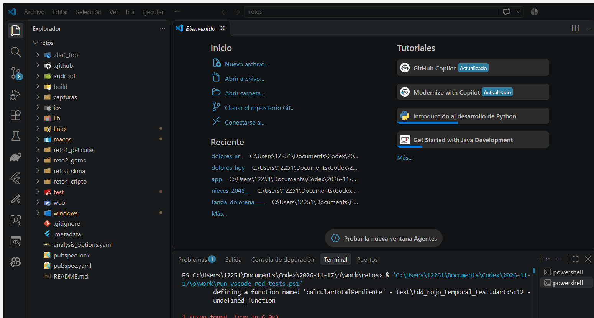
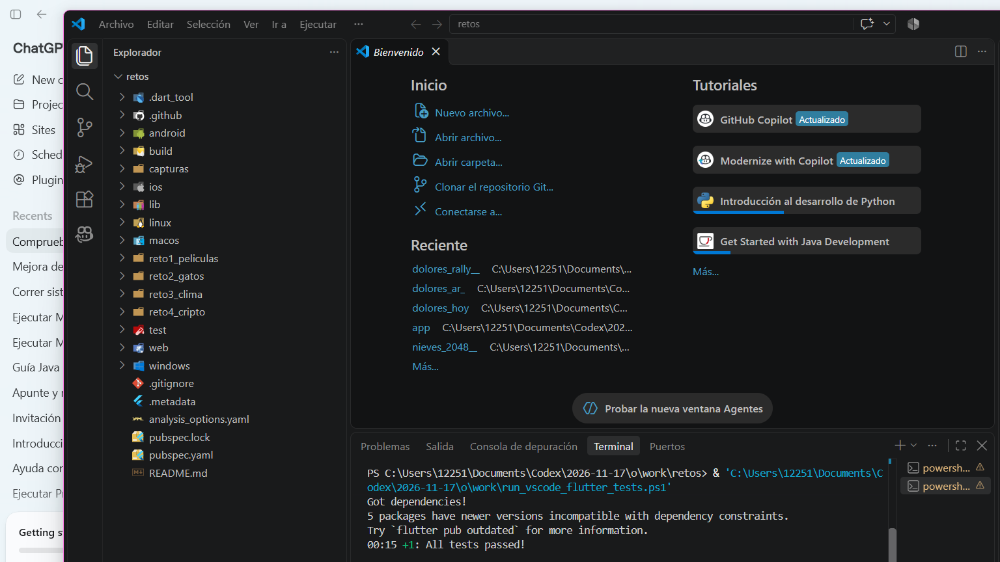

# Retos Flutter

Proyecto de Maria Valeria Molina Rosas.

La aplicación junta varios retos pequeños:

- Películas y recomendaciones.
- Memes de gatos.
- Consulta del clima.
- Un reto de criptomonedas.

## Capturas de la aplicación


## Cómo ejecutarlo

```bash
flutter pub get
flutter run
```

## Pruebas

La captura roja enseña el error de una función que todavía no estaba hecha. La captura verde muestra la prueba del proyecto ya terminada.

```bash
flutter test
```

| Prueba con error | Prueba terminada |
|---|---|
|  |  |

Resultado final: **1 prueba aprobada**.
