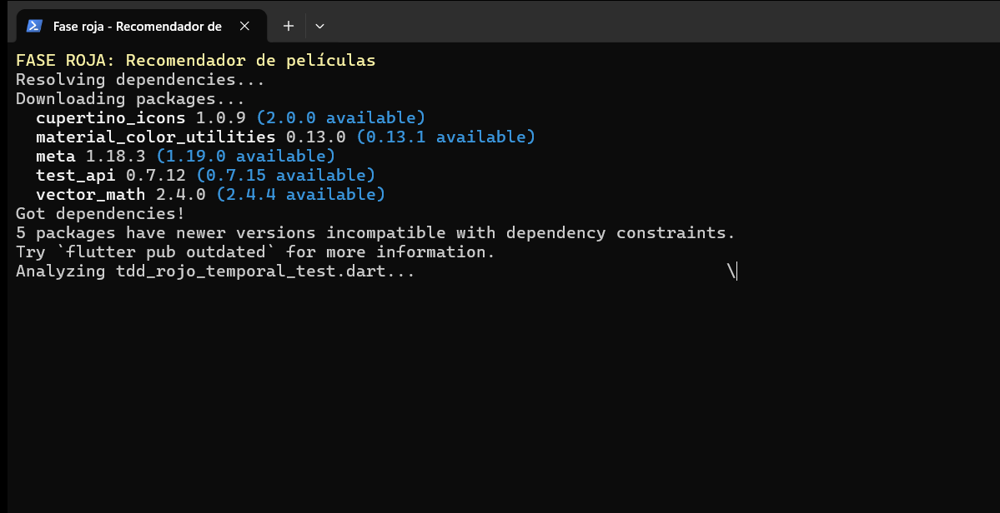
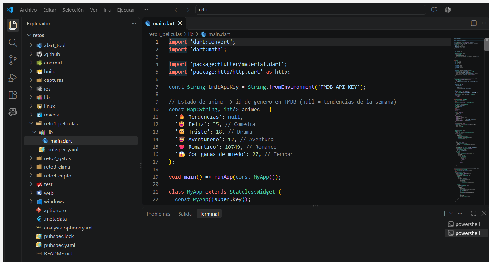
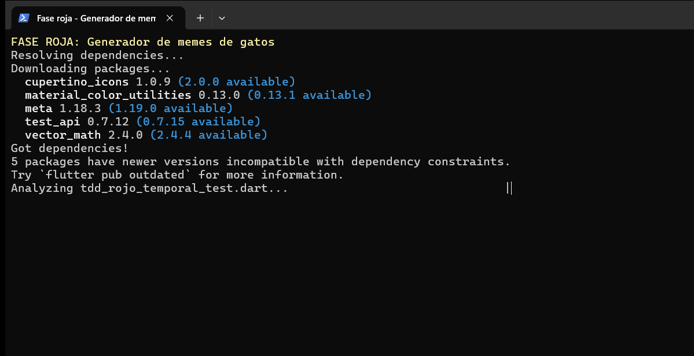
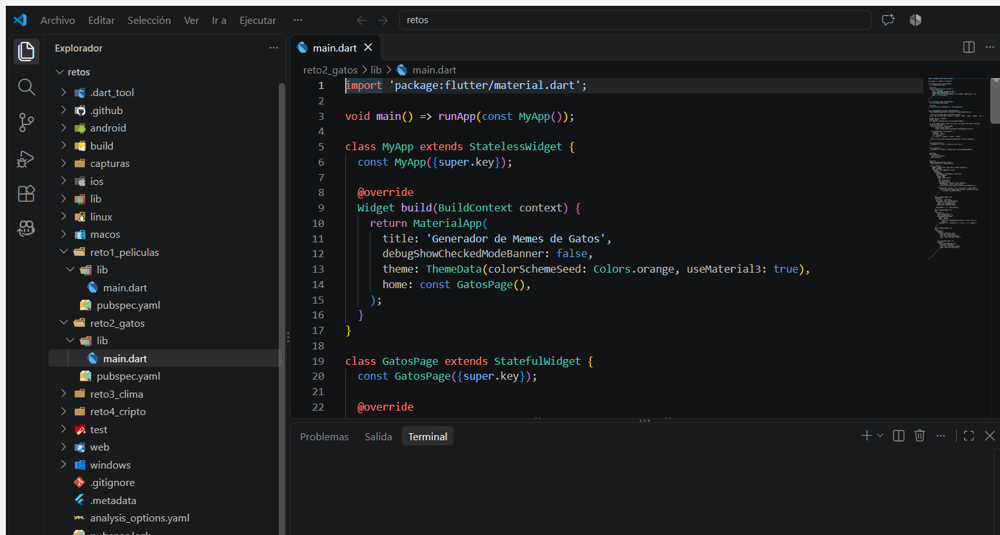
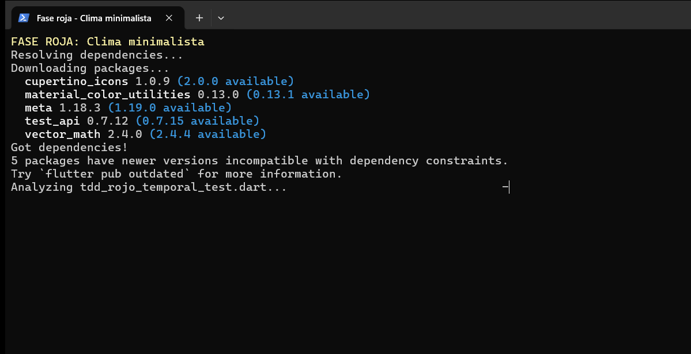
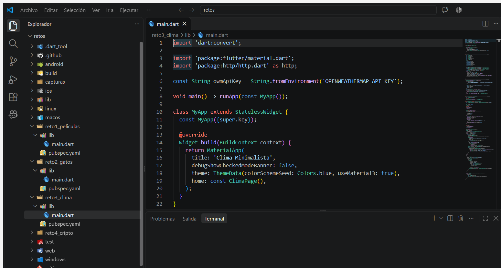
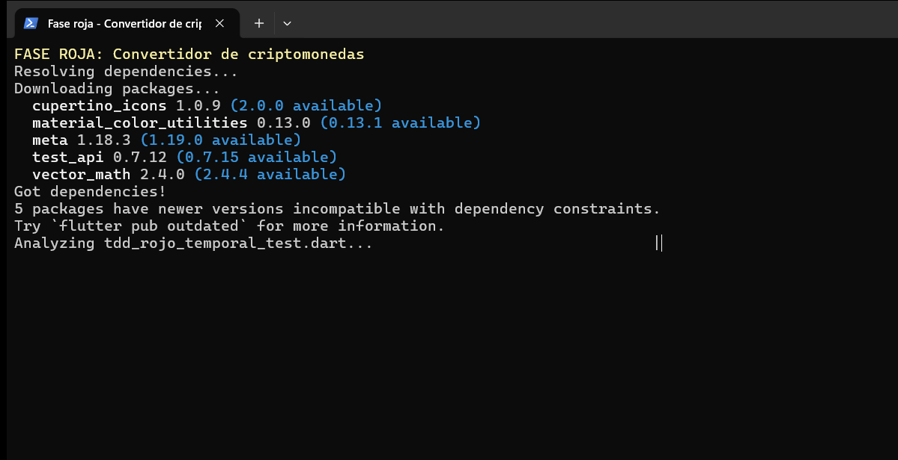
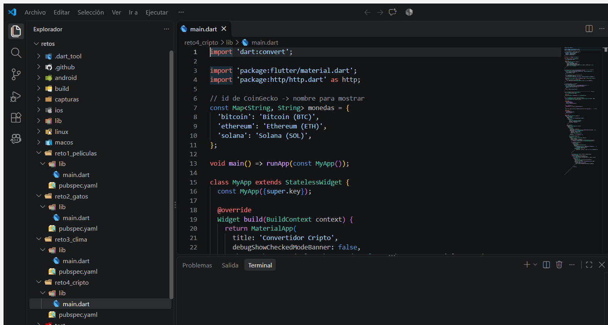
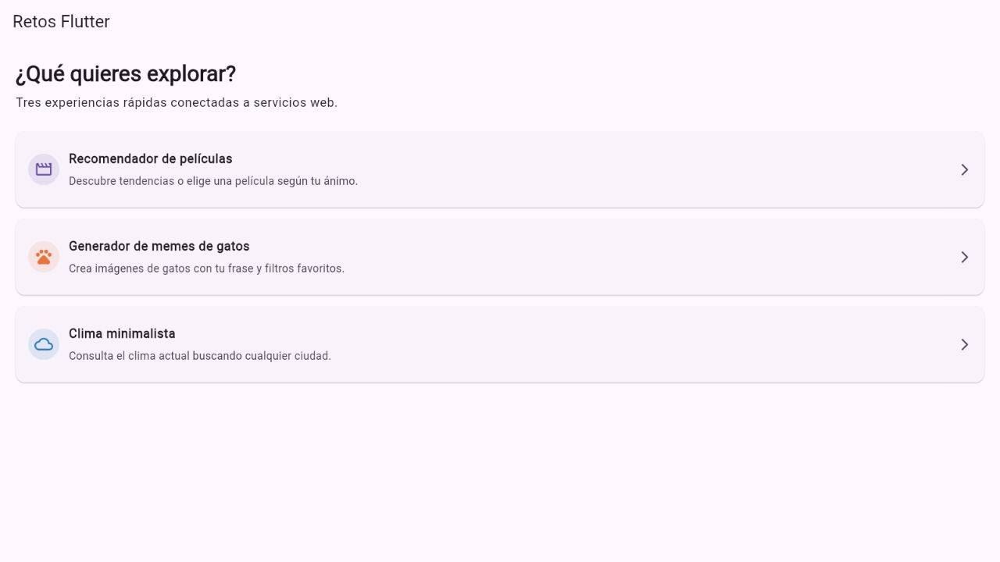

## Fase 1. Recomendador de películas

Este reto consulta películas, permite elegir un estado de ánimo y muestra recomendaciones con título, descripción, fecha y calificación.

### Fase roja

La prueba falla porque todavía falta implementar el código del recomendador.

### Fase verde

Se agrega el modelo, el servicio de películas y la pantalla con las recomendaciones.

## Fase 2. Generador de memes de gatos

Este reto crea imágenes de gatos, permite escribir una frase, elegir un filtro y solicitar otro gato.

### Fase roja

La prueba muestra el error antes de completar el generador.

### Fase verde

Se agrega la construcción de la imagen, el texto, los filtros y los botones de la pantalla.

## Fase 3. Clima minimalista

Este reto consulta el clima por ciudad y muestra temperatura, sensación térmica, humedad, viento y descripción.

### Fase roja

La prueba falla mientras todavía no existe el código necesario para consultar el clima.

### Fase verde

Se agrega el modelo del clima, el servicio de consulta y la pantalla de resultados.

## Fase 4. Convertidor de criptomonedas

Este reto consulta precios y calcula cuánto se puede comprar de Bitcoin, Ethereum y Solana con una cantidad en dólares.

### Fase roja

La prueba muestra el error antes de completar el convertidor.

### Fase verde

Se agrega la consulta de precios, el formato en dólares y el cálculo de cada criptomoneda.

## Aplicación completa

La pantalla principal permite entrar a los retos que están conectados en el menú de la aplicación. El código del reto de criptomonedas también se conserva dentro de su carpeta.

## Resultado

Las cuatro fases quedaron documentadas una por una, con su evidencia roja, su evidencia verde y la captura final de la aplicación.

